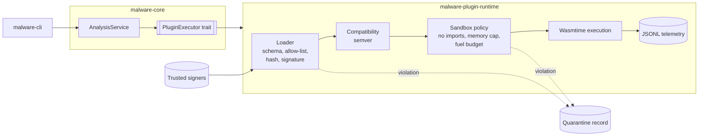

# WebAssembly plugin sandbox

A Rust runtime that loads untrusted analysis plugins as WebAssembly modules. It refuses any plugin it can't verify, and runs the rest with no host access under fixed memory and execution limits.

This repository is a showcase extract from a larger static-analysis tool built for a business. It contains the plugin runtime, the core service, the CLI and the test suite. The rest of the product is not included (see [Not included](#not-included)).

## Why

Analysts want to extend an analysis tool with their own plugins, but those plugins run on a machine that is handling hostile input. A plugin therefore has to be treated as untrusted code. It shouldn't reach the filesystem or network, use unbounded memory or CPU, or be swapped for a tampered copy without anyone noticing.

## What the runtime enforces

Before a plugin runs, it must pass these checks in order, and failing any one of them stops it from loading:

1. **Manifest schema.** `manifest.json` validates against `contracts/plugin-manifest.schema.json`.
2. **Identity.** The plugin name is on the allow-list, and the entry point contains no path separators.
3. **Integrity.** The SHA-256 hash of the module matches the manifest.
4. **Signature.** An Ed25519 signature over `name:version:entrypoint:hash` verifies against a trusted-signer file. Signers can be revoked and carry validity windows, so keys can be rotated.
5. **Compatibility.** The plugin's declared API version is semver-compatible with the runtime.

Inside the sandbox:
- no host imports are allowed, and a module may have at most one memory;
- export signatures are checked before the plugin is called;
- memory is capped through Wasmtime store limits;
- execution is bounded by a fuel budget derived from the configured timeout.

When a plugin breaks a rule, the runtime writes a timestamped violation record, with a copy of the plugin's manifest, under `quarantine/`. Runtime events are logged as versioned JSONL in `artifacts/runtime-events.jsonl`.

## Architecture



| Crate | Responsibility |
|---|---|
| `crates/core` (`malware-core`) | Request and result types, `CoreError`, `AnalysisService`, and the `PluginExecutor` port |
| `crates/plugin_runtime` (`malware-plugin-runtime`) | Loader, compatibility checks, sandbox policy, Wasmtime executor, quarantine and telemetry |
| `crates/plugin_sdk` (`malware-plugin-sdk`) | Types for plugin authors |
| `crates/cli` (`malware-cli`) | `run` and `validate-package` commands |
| `tests/integration` | Contract, boundary and CLI–core parity tests |

The core depends only on the `PluginExecutor` trait, so adapters stay thin, and a parity test checks that the CLI and the core produce the same results. The design notes are in [`docs/architecture`](docs/architecture). They include ADR-0001, on why the runtime fails closed rather than trusting plugins by location or only warning, and a threat model.

## Design decisions

- **Fail closed.** A plugin that is missing a field, has a stale signature or carries an unexpected import is rejected, not loaded with a warning.
- **Sign the metadata, not just the bytes.** Signing the name, version and entry point alongside the hash stops a valid module being re-labelled as a different plugin or version.
- **A minimal Wasmtime build.** Only the Cranelift compiler and the core runtime are compiled in, on the Wasmtime 36 long-term-support line. The component model, pooling allocator, compilation cache and parallel compilation are left out. That keeps the attack surface and the dependency tree small; CI audits it against the RustSec database.
- **A narrow plugin ABI.** Plugins export integer-only functions that return scores in basis points. No pointers or strings cross the boundary, which removes a class of memory-safety issues at the cost of expressiveness.

## Getting started

Requirements: [rustup](https://rustup.rs/). The toolchain is pinned to Rust 1.94.0 in `rust-toolchain.toml` and is installed automatically.

```bash
cargo test --workspace --locked
```

CLI:

```bash
cargo run -p malware-cli -- validate-package --plugin <name>
cargo run -p malware-cli -- run --plugin <name> --sample <path>
```

Plugins are discovered under `plugins/<name>/`; see [`plugins/plugins.md`](plugins/plugins.md) for the package layout. Trusted signers are read from `contracts/trusted-signers.json`, which is ignored by git; `contracts/trusted-signers.example.json` shows the format. They can also come from the environment variables described in [`crates/plugin_runtime/plugin_runtime.md`](crates/plugin_runtime/plugin_runtime.md). No plugin is shipped, but the integration tests build and sign their own fixtures.

## Tests

The suite has 21 tests: 18 runtime-contract tests, 2 CLI–core parity tests and 1 core unit test. The integration tests compile Wasm fixtures from WAT source, sign them with a fixed test key, and exercise each rejection path:

- schema violations, hash mismatches, incompatible versions and invalid modules;
- denied imports, bad export signatures and the memory cap;
- quarantine and telemetry output;
- network allow and deny policy;
- cold-start and warm-start latency budgets.

CI runs `cargo fmt --check`, `clippy -D warnings`, the tests against the lockfile, and a RustSec dependency audit.

## Limitations

- **No analysis yet.** The analysis pipeline isn't implemented in the original product. The runtime executes plugins and returns scores, but there are no disassembly or deobfuscation plugins.
- **Fuel only approximates a timeout.** The fuel budget isn't a wall-clock limit.
- **One capability is policed.** The capability policy currently controls only network egress.
- **The WIT interface is documentation only.** `contracts/analysis.wit` documents the intended interface, but the runtime uses plain integer exports.
- **Paths depend on the working directory.** Paths for contracts, plugins, quarantine and telemetry are resolved relative to the working directory.

## Not included

These parts of the original product are not part of this showcase:

- the desktop application and its command bridge [Redacted];
- an earlier iteration with a C# client calling a native Rust library over FFI [Redacted];
- product planning, process and governance documents [Redacted].

## Author

Muhammad Hussain ([mh-husssain](https://github.com/mh-husssain))
