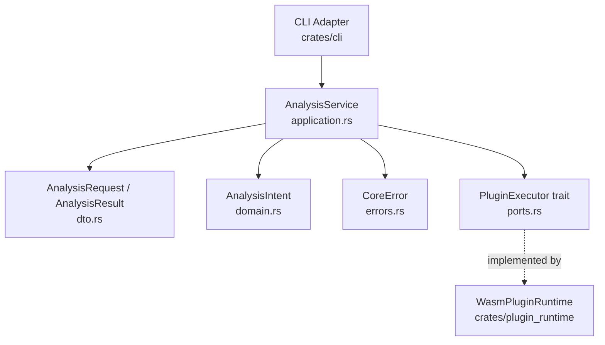

# Component Model: Core Container

Container: crates/core
Status: Implemented

## Behavioral Notes

- AnalysisService validates sample_path non-emptiness before runtime delegation.
- Input payload is normalized to ensure sample_path exists before executor call.
- Runtime output is normalized to stable AnalysisResult fields (summary, risk_score, raw_output).
- Core depends on abstraction (PluginExecutor), not runtime concrete types.
