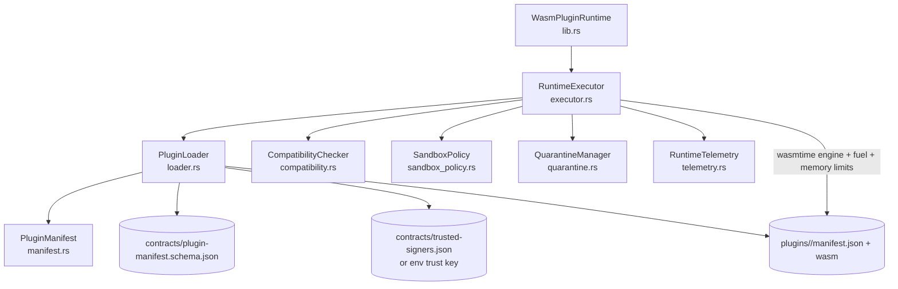

# Component Model: Runtime Container

Container: crates/plugin_runtime
Status: Implemented

## Validation and Execution Pipeline

1. Validate runtime sandbox policy (non-zero memory and timeout).
2. Load manifest and enforce schema + identity + entrypoint constraints.
3. Verify entrypoint SHA-256 and Ed25519 signature against trusted signers.
4. Validate API and manifest compatibility channels.
5. Enforce capability policy (net.egress denied unless policy allows it).
6. Validate module structure, import policy, and required export signatures.
7. Execute under Wasmtime with fuel and memory limits.
8. Emit telemetry for success/failure and write quarantine artifacts on violations.

## Security-Critical Constraints

- Fail-closed behavior on validation or policy failure.
- Non-approved host imports are denied.
- Entry function signature must match structured or legacy approved ABI.
- Runtime emits forensic breadcrumbs (quarantine + telemetry) for denied paths.
