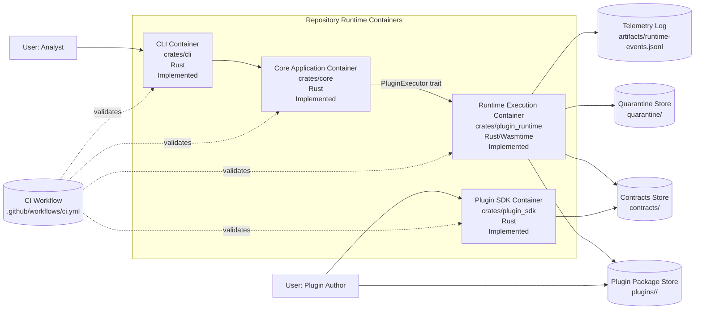

# Container Model

Status: Implemented.

## Container Responsibilities

- CLI container: argument parsing, command dispatch, result rendering.
- Core container: request normalization and domain orchestration.
- Runtime container: validation, policy enforcement, Wasmtime execution, telemetry, and quarantine.
- SDK container: plugin-author contract validation and typed ABI models.
