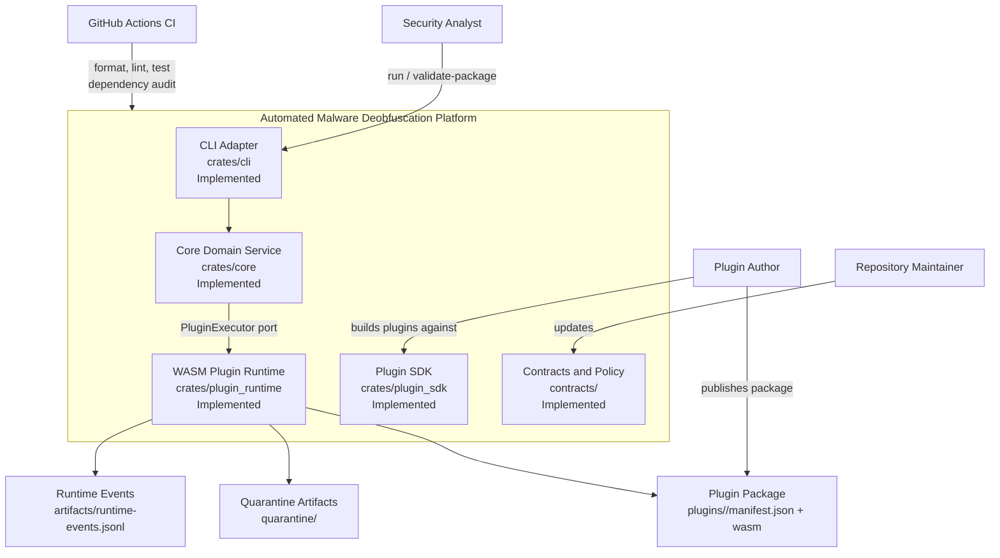

# Context Model

Status: Implemented (CLI, core, runtime and SDK).

## Scope

The system is a Rust-first malware analysis platform where execution of untrusted plugin packages is mediated by a runtime adapter with fail-closed validation and sandbox policy checks.

## Key Context Assertions

- Plugin artifacts are untrusted by default and must pass manifest, compatibility, integrity, signature, and policy checks before execution.
- CI enforces formatting, lints, tests against the lockfile, and a dependency vulnerability audit.
