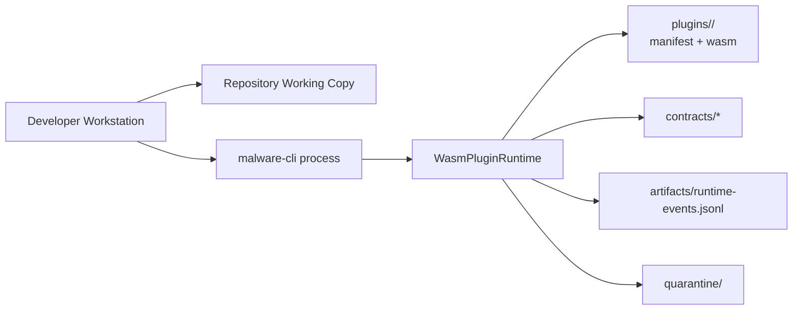
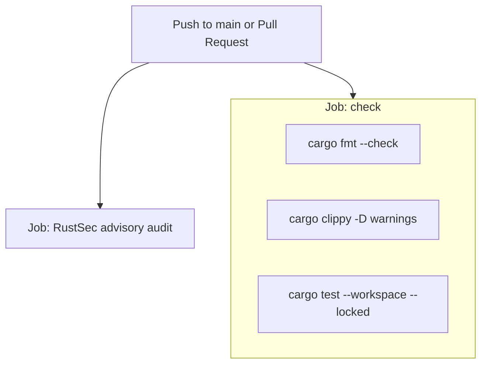

# Deployment Model

Status: Implemented for local Rust development and CI.

## Local Development Topology

## CI Topology

## Deployment Assertions

- The Rust toolchain is pinned in rust-toolchain.toml and dependencies resolve from the committed Cargo.lock.
- Runtime paths (contracts/, plugins/, quarantine/, artifacts/) are resolved relative to the working directory.
