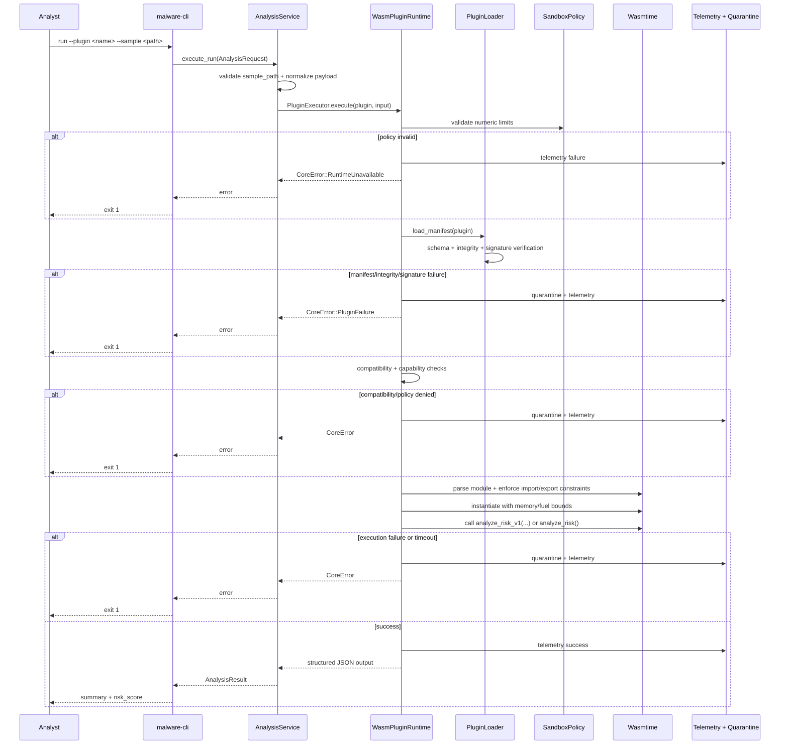

# Dynamic Model: CLI Analysis Flow

Entry Point: crates/cli/src/main.rs run command
Status: Implemented

## Notes

- validate-package follows the same validation stages but stops before analysis execution.
- Structured ABI is preferred; legacy scalar ABI is supported as compatibility fallback.
