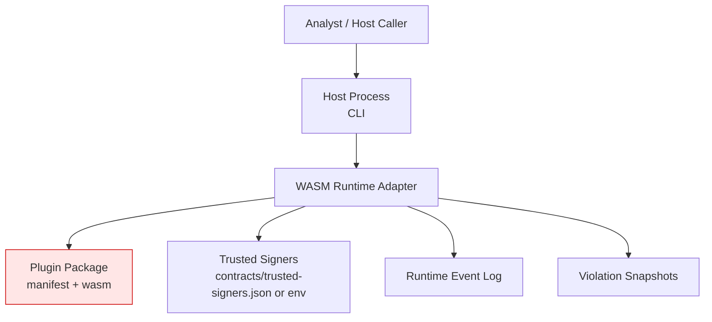

# Threat and Trust Model

Status: Implemented baseline with explicit controls in crates/plugin_runtime.

## Trust Boundaries

## Primary Risks and Implemented Controls

1. Manifest tampering or schema abuse.
- Control: JSON Schema validation against contracts/plugin-manifest.schema.json.

2. Entrypoint substitution or binary drift.
- Control: SHA-256 integrity check against manifest.integrity.sha256.

3. Untrusted signer acceptance.
- Control: Ed25519 signature verification against active trusted signers set.

4. Capability overreach.
- Control: policy gate enforcement (for example, net.egress denied by default).

5. Runtime escape via host imports.
- Control: import policy denies non-approved host imports.

6. ABI misuse or malformed exports.
- Control: strict export signature validation for structured and legacy entrypoints.

7. Resource exhaustion.
- Control: Wasmtime memory limits and fuel budget derived from timeout policy.

8. Poor incident recoverability.
- Control: telemetry emission and quarantine records on denied/failure paths.

## Residual Risks (Current State)

- Sample plugin artifact is placeholder-only, so end-to-end realistic plugin behavior is not yet validated against a real signed WASM module in this repository.

## Security Invariants

- Validation failure is terminal for execution (fail-closed).
- Runtime is the only allowed plugin execution boundary.
- Trust material must be configured; absent trusted signer configuration fails runtime operations.
